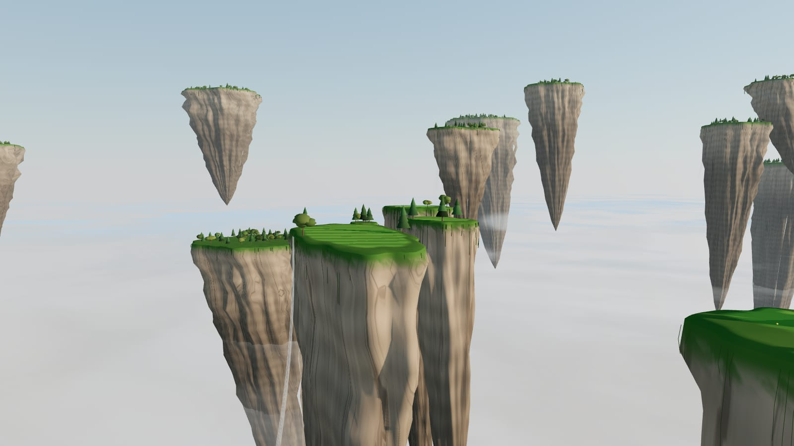

# VibeGolf

A golf simulator, vibe-coded with Claude, for the **Garmin Approach R10**, built as a plain web app with no build step. You can play it in a browser, install it to a PC or phone home screen, and host it on GitHub Pages.



| Mode | What it is |
|---|---|
| **Woodson Range** | Driving range with stacked shot tracers, a dispersion plot, club gapping, adjustable conditions, and lift/drag trims to match the flight model to your R10. |
| **The Aerie** | Three holes on floating sky islands. Each hole has a safe route and a carry-the-gap route. Target picks, a shot preview, a corner hole map, penalty drops and auto-putting. |
| **Mini games** | Next up: closest to the pin, target darts, long drive. |

## Play

- **Online:** https://rhysfreitas.github.io/VibeGolf/ (the repo is [rhysfreitas/VibeGolf](https://github.com/rhysfreitas/VibeGolf))
- **Locally:** `npm start`, then open http://localhost:8080. Any static server works; the pages use ES modules, so opening them from `file://` does not.
- **Install as an app:** tap **Install app** on the title screen. Chrome and Edge (desktop and Android) show their install prompt. On iPhone/iPad it is Safari's **Share → Add to Home Screen**, and on a Mac with Safari it is **File → Add to Dock**. Firefox on desktop can't install web apps. Once installed, VibeGolf runs full screen and works offline.

Without an R10 connected, every swing is simulated from tour-average launch data with realistic dispersion. Shot data can be adjusted in the range's **Adjust** panel.

### Controls

The layout is built for a phone held sideways (landscape), like a launch-monitor setup. The camera stands just behind the ball, which sits at the bottom center of the screen, and the controls are on the left. It also works on a desktop or tablet, and in portrait.

| | Range | Course |
|---|---|---|
| Hit | **Hit** (bottom left), or `Space` | **Hit** (bottom left), or `Space` |
| Club & shot | The club chip next to Hit opens the fly-out: club, simulated swing numbers, tracer, sound, conditions, flight trim | The club chip opens club, swing length and sound |
| Aim | — | **◀ ▶** above Hit, `←` `→`, or tap the course to aim at a spot |
| Numbers | Readout bottom right. Tap it for direction, axis, descent and hang | Readout bottom right. Tap it for ball speed, launch, spin and axis |
| More | **Session** (above the readout) opens the dispersion map, gapping and shot list. `X` clears tracers, `1`–`8` pick clubs | **Play to** (under the hole card) picks the target. Tap the corner map, or press `M`, for the whole hole |

## Connect the R10

A browser can't talk to the R10 over Bluetooth on every platform, and it can't open raw TCP sockets. So a small **bridge** runs on the same computer. Existing R10 connectors already speak **GSPro Open Connect**. The bridge pretends to be GSPro for them and relays each shot into the game over a WebSocket.

```
R10 ──Bluetooth──> connector (OpenLaunch Connect, gsp-r10-adapter, …)
                       │ GSPro Open Connect, TCP 921
                       ▼
                  bridge/  ──WebSocket ws://localhost:8921──> VibeGolf
```

1. Install [Node.js](https://nodejs.org) 18 or newer.
2. Start the bridge:
   ```sh
   cd bridge
   npm install
   npm start            # options: --tcp 921 --ws 8921
   ```
   On Linux, ports below 1024 need `sudo`. Otherwise pick another `--tcp` port and point the connector at it.
3. Start your connector in GSPro mode, pointed at `127.0.0.1` port `921`:
   - [OpenLaunch Connect](https://github.com/chgl42/openlaunch-connect) (macOS): direct Bluetooth to the R10, no phone needed.
   - [gsp-r10-adapter](https://github.com/mholow/gsp-r10-adapter) (Windows): see its README for the direct-Bluetooth and Garmin-app relay modes.
4. In the game, tap the **R10** status and press **Connect** (default `ws://localhost:8921`). The dot turns green when shots are flowing. Live shots are tagged **R10** in the readout. The game sends the club you select back to the connector.

Chrome and Edge allow a page served over `https://` to reach `ws://localhost`. If your browser blocks that connection, run the game locally with `npm start`.

## How it works

```
index.html            title screen
range.html            Woodson Range
course.html           The Aerie
src/physics.js        ball flight, bounce, roll, cup (pure functions, SI units, no Three.js)
src/launch-monitor.js live shot link + connection popover, shared by every page
src/range/main.js     range scene, tracers, cameras, session stats
src/course/main.js    island renderer, course-management UI, cameras, scoring
src/course/aerie.js   hole data: islands, targets, drop zones (the future course builder's format)
src/course/minimap.js corner hole map
bridge/               GSPro Open Connect → WebSocket relay (Node)
vendor/three-r147/    Three.js r147 plus Sky and Line2 add-ons, vendored so the app works offline
tests/                physics calibration and bridge tests (`npm test`)
```

**Ball flight.** The flight is integrated with RK4 at 240 Hz, using gravity, drag and Magnus lift. The drag coefficient rises with spin ratio and below about 50 m/s (Reynolds effect). The lift coefficient saturates with spin ratio, and spin decays exponentially. The coefficients were fit to TrackMan PGA Tour averages. Carry, apex and landing angle land within about 4% from driver to pitching wedge, and `npm test` fails if a change drifts more than 5%. Air density comes from temperature, altitude and humidity.

**Ground.** Bounces use an impulse model with Penner's speed-dependent restitution. Friction depends on spin, and each surface (fairway, green, rough, sand) has its own turf loss. Rolls feel slope and rolling resistance. On the course, the ground function returns `null` over open air, so balls can fall into the clouds, hit cliff faces or roll off edges.

## Developing

- `npm test` runs the physics calibration and the bridge end-to-end tests.
- Change a page, refresh the browser. There is no build. Push to `main` and GitHub Pages redeploys in about a minute. The service worker fetches from the network first, so pushes show up on the next load.
- Course holes are data in `src/course/aerie.js`. Each island is a superellipse with a top height and rock depth, plus optional green, bunkers, waterfalls and trees. Targets and drop zones sit beside the islands.
- Test hooks for headless screenshots: `window.__lowq = true` (set before load) lowers render quality, `__advance(seconds)` steps the simulation, and `window.__pose = { pos, look, fov }` poses the course camera.

## Roadmap

- Mini games: closest to the pin, target darts, long drive
- Course builder that reads and writes the hole format
- The rest of The Aerie (holes 4–18)
- Live wind, and a putting green that uses the R10's putt data
- Native wrappers (Capacitor/Tauri) with direct Bluetooth to the R10
